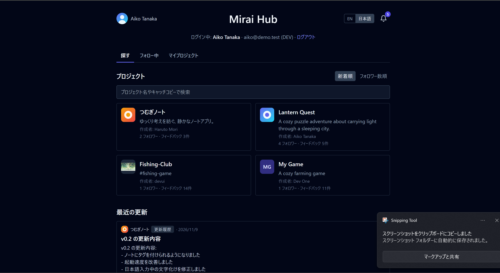
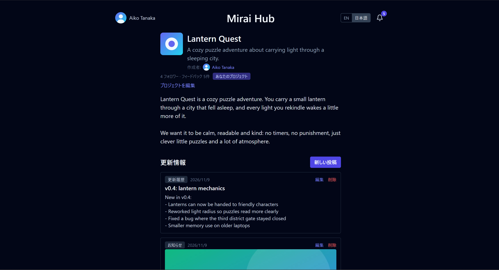
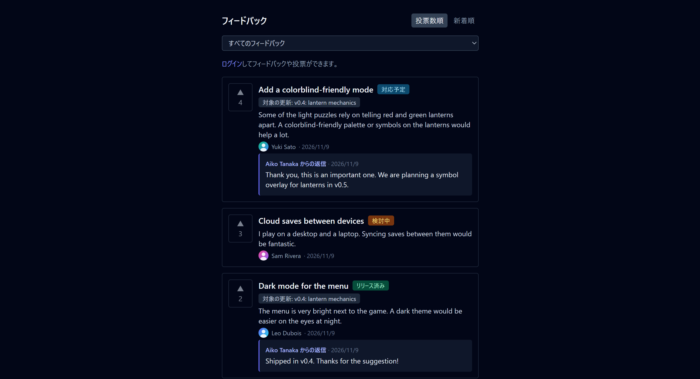
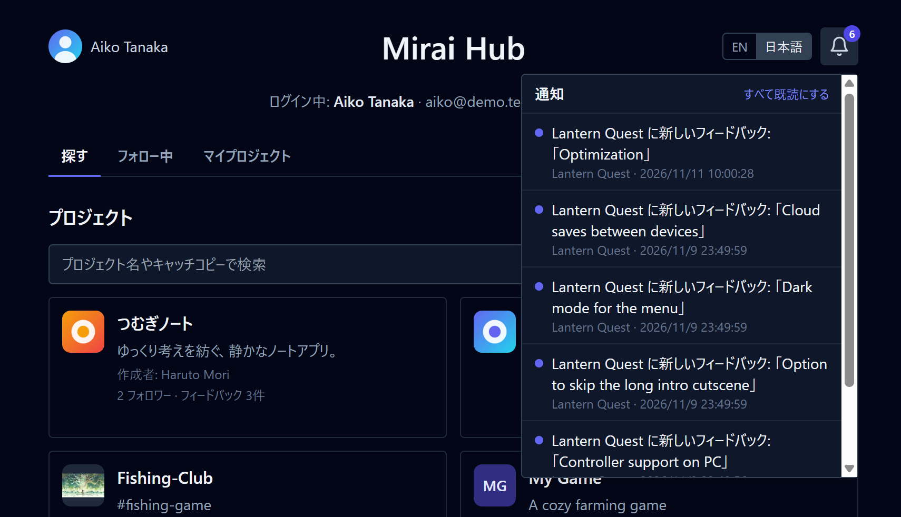
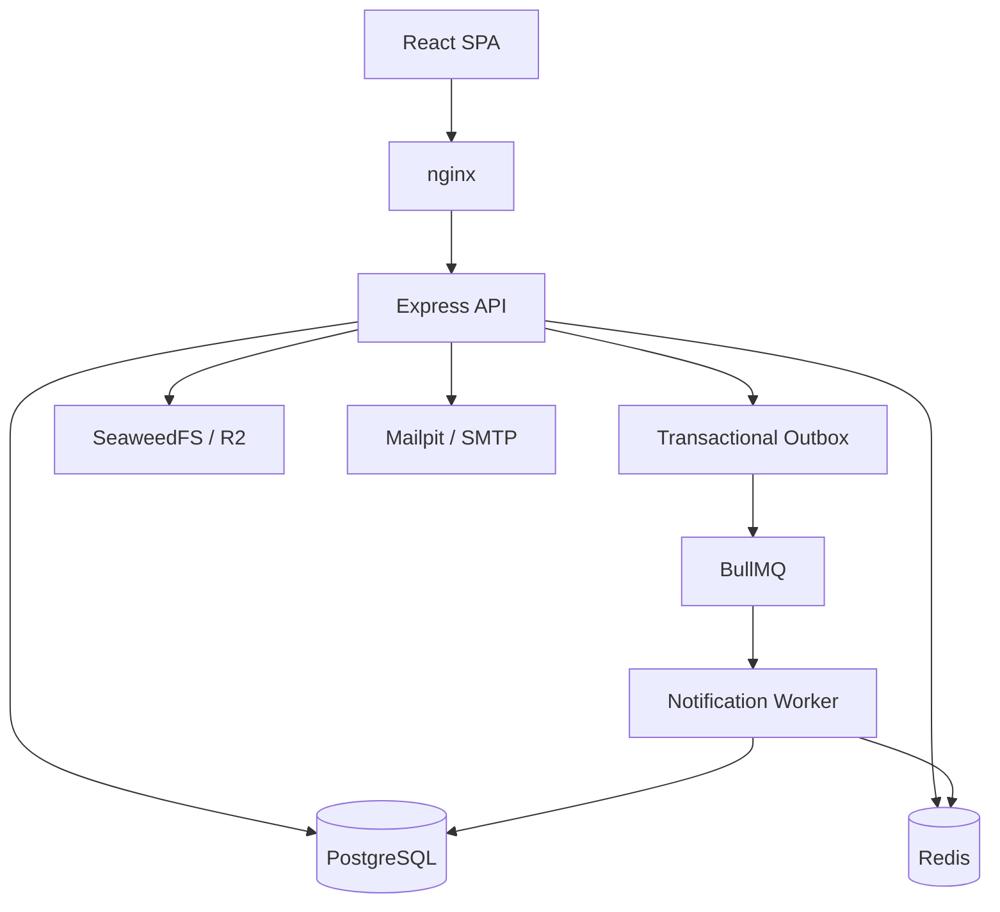

# Mirai Hub

[English](README.md) | [日本語](README.ja.md)

[](https://github.com/oracle-vfts-352/Mirai_Hub/actions/workflows/ci.yml)

**開発者とユーザーをつなぐフィードバックプラットフォーム。**

Mirai Hub は、開発者や企業がプロジェクトを公開し、アップデートを共有し、ユーザーからフィードバックを収集できる Web アプリケーションです。

ユーザーはプロジェクトをフォローし、フィードバックを投稿し、アイデアに投票できます。開発者はフィードバックのステータスを更新し、公式返信を投稿することでユーザーに対応できます。

ユーザーが意見を共有し、開発者が対応し、その進捗がユーザーに通知されるというフィードバックの循環を実現することを目的としています。

## ライブデモ

**https://mirai-hub.onrender.com/**

デモは無料のホスティングで動いているため、以下の点にご注意ください。

- **初回の読み込みに 1 分ほどかかることがあります。** 無料サービスはアイドル時にスリープし、起動に時間がかかるためです。
- サインインしなくても、用意済みのプロジェクト（`lantern-quest` と `tsumugi-notes`）を閲覧できます。
- **フォロー・投票・フィードバック投稿には、ご自身の Passkey でサインアップしてください。** デモではメールを送信しないため、新規アカウントは自動的に認証済みになります。
- **用意済みのデモユーザーとしてはサインインできません。** 彼らは Passkey を持たず、開発用ログインはデプロイ済みデモでは無効になっています。
- デモではメールリンクによるログインは利用できません。

デモは Render（API・Worker・Web アプリを 1 つのサービスで稼働）、Neon（PostgreSQL）、Render Key Value（Redis）、Cloudflare R2（画像）で構成されています。

## スクリーンショット

スクリーンショットは [`docs/screenshots/`](docs/screenshots/) にあります。

| ホーム / Discover | プロジェクトページ |
|---|---|
|  |  |

| フィードバック | 通知 |
|---|---|
|  |  |

## 機能

### 認証・アカウント
- Passkey（WebAuthn）による登録・ログイン
- メールアドレスの認証（フォロー、投票、フィードバック投稿、アバターのアップロード、プロジェクト作成の前に必須）
- 既存の認証済みアカウント向けメールリンクログイン（Passkey の端末を紛失した場合の復旧手段）
- プロフィールから新しい端末に Passkey を追加
- HttpOnly Cookie を使用した JWT 認証
- トークンの失効: ログアウトでトークンを無効化し、「すべての端末からログアウト」でそのユーザーの全セッションを無効化
- 自己紹介とアバターを持つユーザープロフィール

### プロジェクトの探索
- 公開プロジェクトの閲覧・検索
- Discover、Following、My Projects の各ビュー
- ロゴ、ビジョン、アップデート投稿（任意でカバー画像付き）を持つ公開プロジェクトページ
- プロジェクトのフォロー・解除

### フィードバック管理
- プロジェクトへのフィードバック投稿
- フィードバックへの投票
- フィードバックとプロジェクト投稿の紐付け
- プロジェクトオーナーによるステータス更新（全 6 種類）:
  - Open（受付中）
  - Under review（検討中）
  - Planned（計画中）
  - In progress（進行中）
  - Shipped（リリース済み）
  - Declined（却下）
- フィードバックごとにプロジェクトオーナーが公式返信を 1 件投稿可能
- プロジェクトオーナーは自分のプロジェクトに投票やフィードバック投稿ができない

### 通知
- フォロワーへ新しい投稿とステータス変更を通知
- フィードバックの投稿者と投票者全員へオーナーの返信を通知
- プロジェクトオーナーへ新しいフィードバックを通知
- トランザクショナル Outbox と BullMQ による非同期処理

### 画像
- アバター、プロジェクトロゴ、投稿のカバー画像
- アップロードは API 経由: マジックバイトの検査（PNG・JPEG・WebP のみ）、`sharp` による再エンコード（メタデータや画像以外のデータを除去）、サーバー側で決めるストレージキー

### 多言語対応
- 英語・日本語の UI
- 言語切り替え（次回以降も保持）

## 技術スタック

| カテゴリ | 技術 |
|---|---|
| フロントエンド | React 18, TypeScript |
| スタイリング | Tailwind CSS 3 |
| ビルドツール | Vite 5 |
| バックエンド | Node.js, Express 4, TypeScript |
| データベース | PostgreSQL 16 |
| ORM | Prisma 5 |
| キュー | BullMQ |
| キャッシュ / レート制限 | Redis, ioredis |
| 認証 | WebAuthn / Passkeys, JWT |
| バリデーション | Zod |
| 画像処理 | sharp |
| テスト | Vitest, Supertest |
| オブジェクトストレージ | S3 互換: SeaweedFS（ローカル）、Cloudflare R2（デモ） |
| メール | Nodemailer, SMTP |
| ローカルメールテスト | Mailpit |
| インフラ | Docker Compose, nginx（ローカル）, Render（デモ） |
| CI | GitHub Actions |

## アーキテクチャ



ローカルの Docker 環境では、nginx がビルド済みフロントエンドを配信し、Express バックエンドへの API リクエストもプロキシします。そのためブラウザからは単一のオリジンに見え、HttpOnly Cookie と WebAuthn が問題なく動作します。

アプリケーションデータは PostgreSQL に保存します。Redis はレート制限、トークンの失効リスト、BullMQ に使用します。通知イベントは、その原因となった変更と同じデータベーストランザクション内で Outbox テーブルに記録され、その後キューへ転送されます。Worker がキューのイベントを処理し、通知を作成します。

SeaweedFS はローカルで S3 互換のオブジェクトストレージとして、Mailpit はローカルのメールの受け口として使用します。

**デモ環境:** 同じコードを 1 つの Render サービスとして実行しています。API がビルド済みの Web アプリも配信し（こちらも単一オリジン）、Worker、Outbox の Relay、孤立アカウントの清掃は API プロセス内で動きます（`RUN_WORKER=true`）。メールサーバーがないため、`DEMO_MODE=true` で新規アカウントを認証済みにします。seed スクリプトは起動時に実行されます。

## 設計上の判断

### Transactional Outbox

通知イベントは、関連するアプリケーションの変更と同じデータベーストランザクション内で記録されます。その後、Relay が未配信イベントを BullMQ に公開します。Redis や Worker が停止していても、イベントはテーブルに安全に残り、復旧後に配信されます。

これにより、データベース操作が成功した一方でキューへの公開が失敗した場合に、通知イベントが失われることを防ぎます。重複処理も問題になりません。ジョブ ID と通知の一意制約により、Worker は冪等に動作します。

### 非同期通知処理

通知の配信処理は API リクエスト内で行わず、Worker が担当します。イベントの種類ごとに通知先（フォロワー、フィードバックの投稿者と投票者、プロジェクトオーナー）が決まり、配信時には対象の投稿やフィードバックがまだ存在するかも確認します。

### Passkey とメール認証

サインアップとログインには Passkey を使用します。Passkey が証明するのは端末であってメールアドレスの実在ではないため、その上にメール認証を追加しています。認証済みメールは、数値の水増しにつながる操作（フォロー、投票、フィードバック）の条件です。メールリンクログインは既存の認証済みアカウントでのみ使え、アカウント作成には使えません。

### トークンの失効

JWT は通常、失効させることができません。本プロジェクトはハイブリッド方式を採用しています。Redis の失効リスト（トークン ID をキーに、残り有効期間と同じ TTL）で個別のトークンを失効させ、PostgreSQL のユーザーごとの `tokenVersion` でそのユーザーの全トークンを一括で失効させます。Redis やデータベースを確認できない場合、保護されたルートは安全側に倒れて拒否します（fail closed）。

### ビジネスルールは Service 層に集約

ルートは入力の検証とサービス関数の呼び出しだけを行い、ルールは素の関数であるサービスが保持して型付きエラーを投げます。これにより、HTTP なしでルールをテストでき、デモ seed でも実際のルールを再利用できます。

### Redis によるレート制限

レート制限の状態を Redis に保存することで、API インスタンス間や再起動後も制限を共有できます。アップロードの制限は IP ではなくユーザー単位です。

### 実インフラに対するテスト

API のテストは、実際の PostgreSQL（専用の `mirai_hub_test` データベース。それ以外への接続は拒否するガード付き）と実際の Redis に対して実行します。モックにしているのはオブジェクトストレージとメール送信だけです。

### 冪等なデモデータ生成

seed スクリプトはデータを消さずに整合させます。デモユーザー、プロジェクト、投稿などを「見つけるか作成する」ため、2 回目の実行では何も新しく作られません。アプリケーション自身のサービス関数を通して作成するので、通常のルールが適用され、通常のイベントも発生します。`seed:clean` は別コマンドで、デモアカウントとそれに属するデータだけを削除します。

## 環境構築（ローカル）

### 必要なもの

- Node.js 22 以上（CI は 22 を使用）
- npm
- Docker Desktop
- Git

### 1. クローンとインストール

```bash
git clone https://github.com/oracle-vfts-352/Mirai_Hub.git
cd Mirai_Hub
npm install
```

### 2. 設定ファイルを作成

以下のファイルはコミットされていません。ローカル開発用の使い捨ての値を使用してください。

**a) ルートの `.env`**（Docker Compose が読み込みます）。`.env.example` をコピーし、`JWT_SECRET`、`POSTGRES_PASSWORD`、`S3_ACCESS_KEY_ID`、`S3_SECRET_ACCESS_KEY` を設定します。1 つでも欠けていると Compose は起動しません。ランダムなシークレットは次のコマンドで作れます。

```bash
node -e "console.log(require('crypto').randomBytes(48).toString('hex'))"
```

**b) SeaweedFS の設定。** `docker/seaweedfs-s3.example.json` を `docker/seaweedfs-s3.json` にコピーし、ルートの `.env` と同じアクセスキーとシークレットを設定します。Compose はこのファイルをマウントするため、ないとローカルの画像ストレージが動作しません。

**c) `apps/api/.env`:**

```
PORT=5000
JWT_SECRET=<ランダムなシークレット>
REDIS_URL=redis://localhost:6380
RP_ID=localhost
ORIGIN=http://localhost:5173
ENABLE_DEV_LOGIN=true
DATABASE_URL=postgresql://mirai_admin:<POSTGRES_PASSWORD>@localhost:5433/mirai_hub?schema=public
TEST_DATABASE_URL=postgresql://mirai_admin:<POSTGRES_PASSWORD>@localhost:5433/mirai_hub_test?schema=public

S3_ENDPOINT=http://localhost:8333
S3_REGION=us-east-1
S3_ACCESS_KEY_ID=<ルートの .env と同じ>
S3_SECRET_ACCESS_KEY=<ルートの .env と同じ>
S3_BUCKET=mirai-media
MEDIA_PUBLIC_URL=http://localhost:8333/mirai-media

SMTP_HOST=localhost
SMTP_PORT=1025
SMTP_FROM=Mirai Hub <noreply@mirai-hub.local>
```

`ENABLE_DEV_LOGIN=true` は、ローカルで用意済みのデモユーザーとしてサインインするために必要です（「デモデータ」を参照）。本番環境では動作しません。

**d) `packages/database/.env`:**

```
DATABASE_URL="postgresql://mirai_admin:<POSTGRES_PASSWORD>@localhost:5433/mirai_hub?schema=public"
```

`docker-compose.yml` で定義されている Postgres ユーザーを使用してください（上の値では `mirai_admin`）。Postgres と Redis は、ローカルにインストール済みのものと衝突しないよう、ポート 5433 と 6380 で公開しています。

### 3. インフラサービスを起動

リポジトリのルートで実行します。

```bash
docker compose up -d postgres-db redis-cache seaweedfs mailpit
docker compose ps
```

Postgres が healthy になるまで待ちます。SeaweedFS は最初のリクエストまで 10 秒ほど必要です。Mailpit の受信箱は http://localhost:8025 です。

### 4. データベースを準備

```bash
cd packages/database
npx prisma migrate deploy
npx prisma generate
cd ../..

docker compose exec -T postgres-db psql -U mirai_admin -d mirai_hub -c "create database mirai_hub_test;"
```

テスト用データベースはテストの実行にのみ必要です。マイグレーションはテスト実行のたびに自動で適用されます。

### 5. API、Worker、フロントエンドを起動

ターミナルを 3 つ使います。

```bash
# ターミナル 1（API）
cd apps/api
npm run dev

# ターミナル 2（通知 Worker）
cd apps/api
npm run worker

# ターミナル 3（フロントエンド、リポジトリのルートで）
npm run dev:web
```

Worker は必須です。Outbox の転送と通知の作成を担当するため、起動していないと通知ベルは空のままになります。

http://localhost:5173 を開いてください。Passkey と Cookie は正確なホストに紐づくため、`127.0.0.1` ではなく `localhost` を使用してください。

## デモデータ

繰り返し実行可能なデモ seed スクリプトを用意しています。`apps/api` で実行します。

```bash
npm run seed
```

デモユーザー 6 人（開発者 2 人、一般ユーザー 4 人）、プロジェクト 2 件、投稿、フォロー、フィードバック、投票、ステータス変更、公式返信、生成した画像（アバター、ロゴ、カバー）を作成します。再度実行しても新しいデータは作られません。デモデータを削除する場合:

```bash
npm run seed:clean
```

**デモユーザーとしてサインイン（ローカルのみ）。** デモアカウントには Passkey がありません。seed の実行後、ブラウザの DevTools の Console に貼り付ける短いスニペットが表示されます。これは開発用ログイン（`ENABLE_DEV_LOGIN=true` で有効）を使い、一般ユーザーの `yuki@demo.test` としてサインインします。オーナー側の画面を確認するには、プライベートウィンドウで同様に `aiko@demo.test`（`lantern-quest` のオーナー）としてサインインしてください。通知ベルに通知が表示されるよう、Worker は起動したままにしてください。

## テストの実行

テストには、PostgreSQL、Redis、そして上記で作成した `mirai_hub_test` データベースが必要です。API と Worker は起動していなくて構いません。`apps/api` で実行します。

```bash
npm test
```

**27 ファイル・222 件の自動テスト**があります。サービス、ルート、認証とトークン失効、認証済みメールの制限、フィードバックのワークフロー、通知の配信、Outbox の Relay、画像アップロード、デモ seed を検証します。全体の実行には数分かかります。

## 継続的インテグレーション（CI）

GitHub Actions が push のたびに、型チェック、ビルド、PostgreSQL と Redis のサービスコンテナを使った全テスト、API イメージと nginx + Web イメージの Docker ビルドを実行します（後者は Web アプリのビルドも兼ねます）。

## 既知の制限事項

- 一覧（フィードバック、投稿、通知）は 50 件までで、ページネーションは未実装
- アカウント削除機能は未実装
- 不適切な画像の通報機能は未実装
- 重複メールアドレスの登録時に `409 Conflict` を返すため、アカウントの存在が判別できる
- Passkey の登録・ログインは手動でテスト済みだが、E2E 自動テストではカバーされていない
- サーバーエラーメッセージとメールは英語のみ
- Redis の失効リストは永続化されていない: Redis のデータが失われると、個別に失効させたトークンが有効期限まで再び使えるようになる（「すべての端末からログアウト」は PostgreSQL に保存されるため影響しない）
- Electron デスクトップシェルは未実装
- ライブデモは無料ホスティングで稼働: アイドル時にスリープし、メールはなく、用意済みのデモアカウントではサインインできない（訪問者は自分の Passkey でサインアップする）
- 独自ドメインと本番用メール DNS（SPF/DKIM）の設定は未実施

## 今後の予定

- [x] フィードバックの基本フロー
- [x] プロジェクト探索・検索
- [x] Passkey 認証
- [x] メール認証・メールリンクログイン
- [x] トークンの失効
- [x] 画像アップロード（アバター、ロゴ、カバー）
- [x] 非同期通知処理
- [x] 英語 / 日本語 UI
- [x] API 自動テスト
- [x] Docker によるローカル環境
- [x] 無料ライブデモのデプロイ
- [ ] ページネーション
- [ ] Electron デスクトップシェル

## ライセンス

本プロジェクトは MIT License の下で公開されています。詳細は [`LICENSE`](LICENSE) を参照してください。