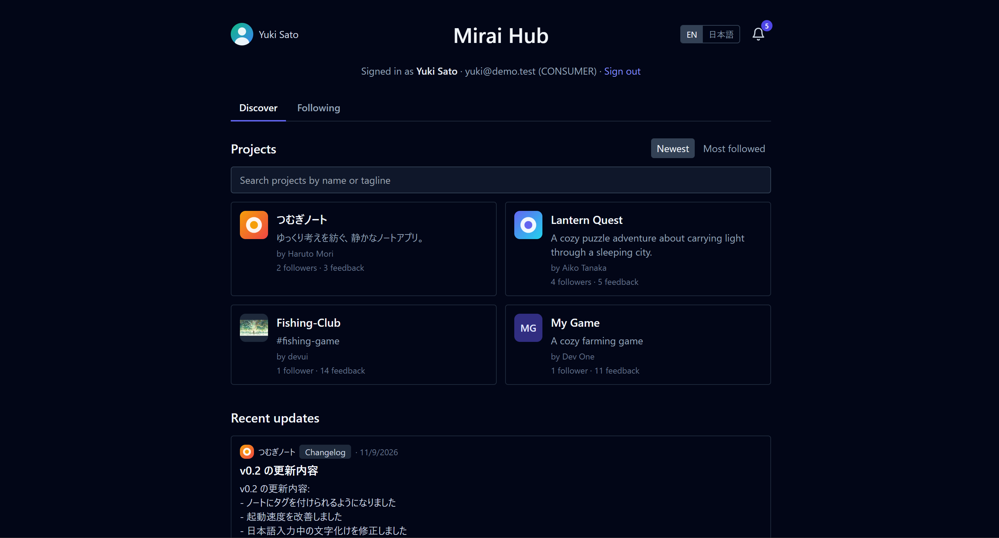
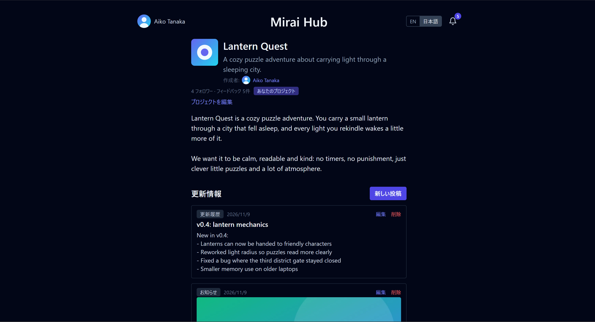
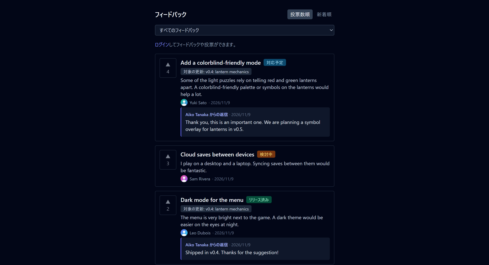
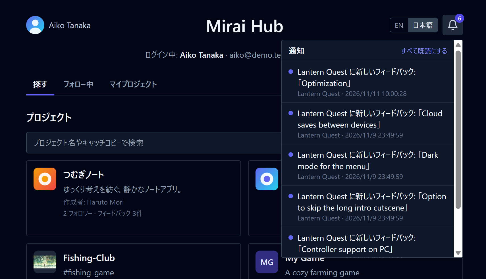
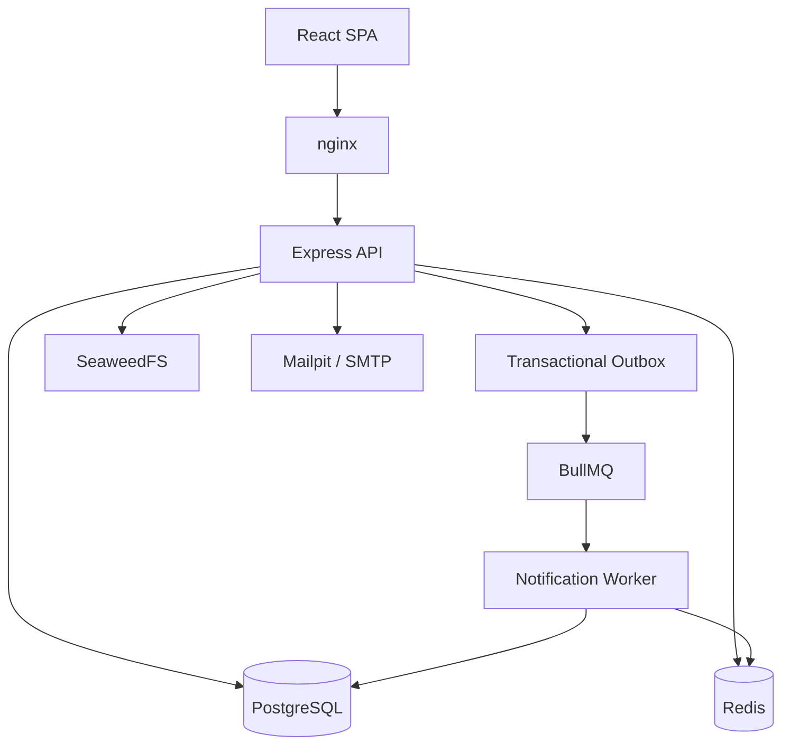

# Mirai Hub

[English](README.md) | [日本語](README.ja.md)

[](https://github.com/oracle-vfts-352/Mirai_Hub/actions/workflows/ci.yml)

**開発者とユーザーをつなぐフィードバックプラットフォーム。**

Mirai Hub は、開発者や企業がプロジェクトを公開し、アップデートを共有し、ユーザーからフィードバックを収集できる Web アプリケーションです。

ユーザーはプロジェクトをフォローし、フィードバックを投稿し、アイデアに投票できます。開発者はフィードバックのステータスを更新し、公式返信を投稿することでユーザーに対応できます。

ユーザーが意見を共有し、開発者が対応し、その進捗がユーザーに通知されるというフィードバックの循環を実現することを目的としています。

## スクリーンショット

スクリーンショットは [`docs/screenshots/`](docs/screenshots/) にあります。

| ホーム / Discover | プロジェクトページ |
|---|---|
|  |  |

| フィードバック | 通知 |
|---|---|
|  |  |

## 機能

### 認証・アカウント
- Passkey による登録・認証
- メールアドレスの認証
- メールリンクによるログイン
- HttpOnly Cookie を使用した JWT 認証
- トークンの失効処理
- ユーザープロフィール

### プロジェクトの探索
- 公開プロジェクトの閲覧
- プロジェクト検索
- Discover、Following、My Projects の各ビュー
- 公開プロジェクトページ
- プロジェクトのフォロー・解除

### フィードバック管理
- プロジェクトへのフィードバック投稿
- フィードバックへの投票
- フィードバックとプロジェクト投稿の紐付け
- プロジェクトオーナーによるステータス更新:
  - Planned（計画中）
  - In Progress（進行中）
  - Shipped（リリース済み）
  - Declined（却下）
- フィードバックごとにプロジェクトオーナーが公式返信を1件投稿可能

### 通知
- フィードバックに関する通知
- ステータス変更および公式返信の通知
- プロジェクト投稿の通知
- Outbox パターンと BullMQ による非同期通知処理

### 多言語対応
- 英語・日本語の UI
- 言語切り替え

## 技術スタック

| カテゴリ | 技術 |
|---|---|
| フロントエンド | React 18, TypeScript |
| スタイリング | Tailwind CSS 3 |
| ビルドツール | Vite 5 |
| バックエンド | Node.js, Express 4, TypeScript |
| データベース | PostgreSQL 16 |
| ORM | Prisma 5 |
| キュー | BullMQ |
| キャッシュ / レート制限 | Redis, ioredis |
| 認証 | WebAuthn / Passkeys, JWT |
| バリデーション | Zod |
| テスト | Vitest, Supertest |
| オブジェクトストレージ | S3 互換 SeaweedFS |
| メール | Nodemailer, SMTP |
| ローカルメールテスト | Mailpit |
| インフラ | Docker Compose, nginx |
| CI | GitHub Actions |

## アーキテクチャ



フロントエンドは nginx 経由で配信され、nginx は Express バックエンドへの API リクエストもプロキシします。

アプリケーションデータは PostgreSQL に保存します。Redis はレート制限と BullMQ に使用します。通知イベントはデータベーストランザクション内で Outbox に記録され、その後キューへ転送されます。Worker がキューのイベントを処理し、通知を作成します。

SeaweedFS はローカル環境で S3 互換のオブジェクトストレージとして使用し、Mailpit はローカルのメールテストに使用します。

## 設計上の判断

### Transactional Outbox

通知イベントは、関連するアプリケーションの変更と同じデータベーストランザクション内で記録されます。その後、Relay が未配信イベントを BullMQ に公開します。

これにより、データベース操作が成功した一方でキューへの公開が失敗した場合に、通知イベントが失われるリスクを軽減します。

### 非同期通知処理

通知の配信処理は API リクエスト内で完結させず、Worker が担当します。これにより、API の処理と通知処理を分離しています。

### Passkey とメール認証

認証には WebAuthn Passkey を使用します。メールアドレス認証とメールリンクによるログインにも対応しています。

### Redis によるレート制限

レート制限の状態を Redis に保存することで、API インスタンス間や再起動後も制限を共有できるようにしています。

### 冪等なデモデータ生成

デモ用 seed スクリプトは繰り返し実行できます。再生成前にデモアカウントを整理し、アプリケーションのサービス関数を使用してビジネスルールを維持しながらデータを作成します。

## 環境構築

### 必要なもの

- Node.js
- npm
- Docker Desktop
- Git

### 1. リポジトリをクローン

```bash
git clone https://github.com/oracle-vfts-352/Mirai_Hub.git
cd Mirai_Hub
```

### 2. 環境変数を設定

`.env.example` をテンプレートとして、リポジトリのルートに `.env` を作成します。

API とデータベースパッケージで必要な環境変数ファイルも設定します。

- `apps/api/.env`
- `packages/database/.env`

必要なシークレットやデータベース設定にはローカル開発用の値を使用してください。

`.env` ファイルを Git にコミットしないでください。

### 3. インフラサービスを起動

リポジトリのルートで実行します。

```bash
docker compose up -d postgres-db redis-cache seaweedfs mailpit
```

PostgreSQL、Redis、SeaweedFS、Mailpit が起動します。

### 4. API を起動

ターミナルを開きます。

```bash
cd apps/api
npm run dev
```

### 5. 通知 Worker を起動

別のターミナルで実行します。

```bash
cd apps/api
npm run worker
```

非同期通知を処理するために Worker の起動が必要です。

### 6. フロントエンドを起動

別のターミナルでリポジトリのルートから実行します。

```bash
npm run dev:web
```

ブラウザで以下を開きます。

http://localhost:5173

ローカルで Passkey を開発する場合は、`127.0.0.1` ではなく `localhost` を使用してください。

## デモデータ

繰り返し実行可能なデモ seed スクリプトを用意しています。

`apps/api` で実行します。

```bash
npm run seed
```

デモデータを削除する場合:

```bash
npm run seed:clean
```

このスクリプトでは、デモユーザー、プロジェクト、投稿、フォロー、フィードバック、投票、ステータス変更、公式返信を作成します。

デモアカウントには Passkey が登録されていません。開発用ログイン機能はローカル開発専用です。

通知を確認するには、通知 Worker を起動しておく必要があります。

## テストの実行

リポジトリのルートから実行します。

```bash
npm test --workspace=api
```

API のテストスイートでは、アプリケーションサービス、ルート、認証関連ロジック、フィードバックのワークフロー、通知処理などを検証します。

最新の報告時点で、**27 テストファイル・222 テストがすべて成功**しています。

## 継続的インテグレーション（CI）

GitHub Actions によって API のチェックと Docker ビルドを実行します。

CI ワークフローには、API の型チェック、ビルド、テスト、Docker イメージのビルドが含まれます。

## 既知の制限事項

- 本番環境へのライブデプロイは未実施
- アカウント削除機能は未実装
- 画像の通報機能は未実装
- 重複メールアドレスの登録時に `409 Conflict` を返すため、アカウントの存在が判別できる可能性がある
- Passkey の登録・ログインは手動でテスト済みだが、E2E 自動テストでは十分にカバーされていない
- サーバーエラーメッセージとメールは英語のみ
- Electron デスクトップシェルは未実装
- HTTPS、本番用メール DNS、クラウドオブジェクトストレージなど、本番デプロイに必要な設定は未完了

## 今後の予定

- [x] フィードバックの基本フロー
- [x] プロジェクト探索・検索
- [x] Passkey 認証
- [x] メール認証・メールリンクログイン
- [x] 非同期通知処理
- [x] 英語 / 日本語 UI
- [x] API 自動テスト
- [x] Docker によるローカル環境
- [ ] Electron デスクトップシェル
- [ ] 任意の無料デモ環境へのデプロイ

## ライセンス

本プロジェクトは MIT License の下で公開されています。詳細は [`LICENSE`](LICENSE) を参照してください。
