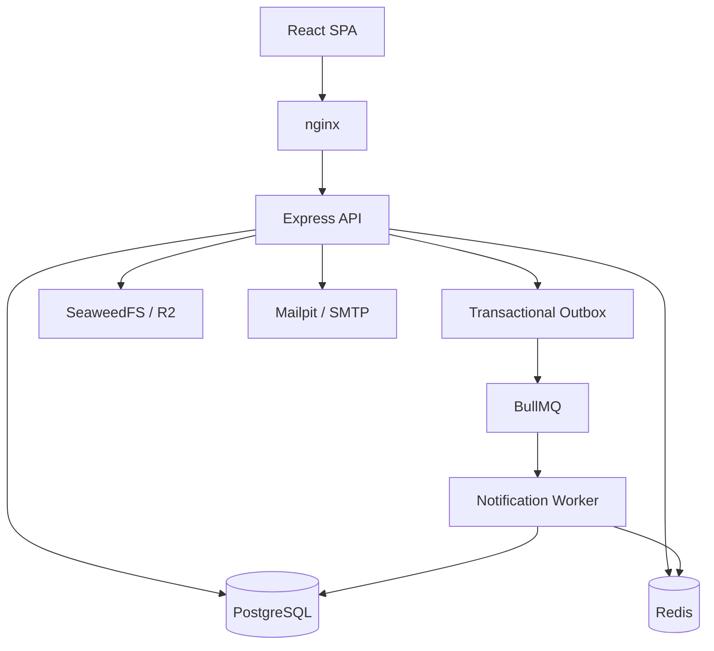

# Mirai Hub

[English](README.md) | [日本語](README.ja.md)

[](https://github.com/oracle-vfts-352/Mirai_Hub/actions/workflows/ci.yml)

**A feedback platform connecting developers and users.**

Mirai Hub is a web application where developers and companies can share their projects, publish updates, and collect feedback from users. Users can follow projects, submit feedback, and vote on ideas. Developers can respond by updating feedback statuses and posting official replies.

The goal is to close the feedback loop: users share their ideas, developers respond, and users are notified of the progress.

## Live Demo

**https://mirai-hub.onrender.com/**

The demo runs on free hosting, so please keep these points in mind:

- **The first load can take about a minute.** The free service sleeps when idle and has to wake up.
- **Browse the seeded projects** (`lantern-quest` and `tsumugi-notes`) without signing in.
- **To follow, vote or give feedback, sign up with your own passkey.** On the demo, new accounts are marked as verified automatically because the demo does not send email.
- **You cannot sign in as the seeded demo users.** They have no passkeys, and the development login is disabled on the deployed demo.
- Email-link sign-in is not available on the demo.

The demo uses Render (API, worker and web app in one service), Neon (PostgreSQL), Render Key Value (Redis) and Cloudflare R2 (images).

## Screenshots

Screenshots are available in [`docs/screenshots/`](docs/screenshots/).

| Home / Discover | Project Page |
|---|---|
|  |  |

| Feedback | Notifications |
|---|---|
|  |  |

## Features

### Authentication and Accounts
- Passkey-based (WebAuthn) registration and sign-in
- Email verification, required before following, voting, giving feedback, uploading avatars, or creating projects
- Email-link sign-in for existing verified accounts (recovery when a passkey device is lost)
- Add a passkey on a new device from your profile
- JWT authentication using HttpOnly cookies
- Token revocation: logout invalidates the token, and "Sign out on all devices" invalidates every session of a user
- User profiles with bio and avatar

### Project Discovery
- Browse and search public projects
- Discover, Following, and My Projects views
- Public project pages with a logo, vision, and update posts (with optional cover images)
- Follow and unfollow projects

### Feedback Management
- Submit feedback to projects
- Vote on feedback
- Link feedback to a project post
- Project owners update the status of a feedback item (six statuses):
  - Open
  - Under review
  - Planned
  - In progress
  - Shipped
  - Declined
- Project owners can write one official reply per feedback item
- Project owners cannot vote or give feedback on their own project

### Notifications
- Followers are notified of new posts and status changes
- The feedback author and everyone who voted are notified of the owner's reply
- The project owner is notified of new feedback
- Asynchronous processing using a transactional outbox and BullMQ

### Images
- Avatars, project logos, and post covers
- Uploads go through the API: magic-byte check (PNG, JPEG, WebP only), re-encoding with `sharp` (strips metadata and any non-image payload), and a server-chosen storage key

### Internationalization
- English and Japanese UI
- Language toggle, remembered between visits

## Tech Stack

| Category | Technology |
|---|---|
| Frontend | React 18, TypeScript |
| Styling | Tailwind CSS 3 |
| Build Tool | Vite 5 |
| Backend | Node.js, Express 4, TypeScript |
| Database | PostgreSQL 16 |
| ORM | Prisma 5 |
| Queue | BullMQ |
| Cache / Rate Limiting | Redis, ioredis |
| Authentication | WebAuthn / Passkeys, JWT |
| Validation | Zod |
| Images | sharp |
| Testing | Vitest, Supertest |
| Object Storage | S3-compatible: SeaweedFS (local), Cloudflare R2 (demo) |
| Email | Nodemailer, SMTP |
| Local Email Testing | Mailpit |
| Infrastructure | Docker Compose, nginx (local), Render (demo) |
| CI | GitHub Actions |

## Architecture



In the local Docker setup, nginx serves the built frontend and proxies API requests to the Express backend, so the browser sees a single origin. This matters for HttpOnly cookies and WebAuthn.

PostgreSQL stores application data. Redis supports rate limiting, the token denylist, and BullMQ. Notification events are written to an outbox table inside the same database transaction as the change that caused them, and then relayed to the queue. A worker processes queued events and creates notifications.

SeaweedFS provides local S3-compatible object storage, and Mailpit catches email locally.

**Demo deployment:** the same code runs as one Render service. The API also serves the built web app (again a single origin), and the worker, outbox relay, and orphan-account cleanup run inside the API process (`RUN_WORKER=true`). `DEMO_MODE=true` marks new accounts as verified because there is no mail server. The seed script runs at startup.

## Engineering Decisions

### Transactional Outbox

Notification events are recorded in the database transaction alongside the related application changes. A relay publishes unpublished events to BullMQ. If Redis or the worker is down, events wait safely in the table and go out later.

This prevents notification events from being lost when a database operation succeeds but queue publishing fails. Duplicate processing is harmless: job ids and a unique key on notifications make the worker idempotent.

### Asynchronous Notifications

Notification fan-out is handled by a worker instead of being performed inside the API request. Each event type routes to the right audience (followers, the feedback author and voters, or the project owner), and the fan-out checks that the post or feedback still exists.

### Passkeys and Verified Email

Passkeys are the way to sign up and sign in. Email verification is added on top, because a passkey proves a device and not that the email address is real. A verified email gates the actions that could inflate counts (follow, vote, feedback). Email-link sign-in only works for existing verified accounts, so it cannot be used to create accounts.

### Token Revocation

JWTs are normally impossible to revoke. This project uses a hybrid design: a Redis denylist (keyed by token id, with a TTL equal to the token's remaining lifetime) revokes a single token, and a per-user `tokenVersion` in PostgreSQL revokes all tokens of a user at once. If Redis or the database cannot be checked, protected routes fail closed.

### Business Rules Live in Services

Routes only validate input and call plain service functions, which hold the rules and throw typed errors. This keeps rules testable without HTTP and lets the demo seed script reuse the real rules.

### Redis-backed Rate Limiting

Rate limits are stored in Redis so they remain consistent across API instances and restarts. Upload limits are per user, not per IP.

### Tests Against Real Infrastructure

The API tests run against a real PostgreSQL database (a separate `mirai_hub_test` database, with a guard that refuses to run against anything else) and real Redis. Only object storage and outgoing mail are faked.

### Idempotent Demo Seed

The seed script reconciles instead of wiping: it finds or creates each demo user, project, post and so on, so a second run creates nothing new. It goes through the application's own service functions, so the normal rules apply and normal events are produced. `seed:clean` is a separate command that removes only the demo accounts and what belongs to them.

## Getting Started (local)

### Prerequisites

- Node.js 22 or newer (CI uses 22)
- npm
- Docker Desktop
- Git

### 1. Clone and install

```bash
git clone https://github.com/oracle-vfts-352/Mirai_Hub.git
cd Mirai_Hub
npm install
```

### 2. Create the configuration files

None of these files are committed. Use throwaway values for local development.

**a) Root `.env`** (read by Docker Compose). Copy `.env.example` and fill in `JWT_SECRET`, `POSTGRES_PASSWORD`, `S3_ACCESS_KEY_ID` and `S3_SECRET_ACCESS_KEY`. Compose refuses to start if one is missing. A random secret can be made with:

```bash
node -e "console.log(require('crypto').randomBytes(48).toString('hex'))"
```

**b) SeaweedFS config.** Copy `docker/seaweedfs-s3.example.json` to `docker/seaweedfs-s3.json` and use the same access key and secret as in the root `.env`. Compose mounts this file; without it local image storage will not work.

**c) `apps/api/.env`:**

```
PORT=5000
JWT_SECRET=<a random secret>
REDIS_URL=redis://localhost:6380
RP_ID=localhost
ORIGIN=http://localhost:5173
ENABLE_DEV_LOGIN=true
DATABASE_URL=postgresql://mirai_admin:<POSTGRES_PASSWORD>@localhost:5433/mirai_hub?schema=public
TEST_DATABASE_URL=postgresql://mirai_admin:<POSTGRES_PASSWORD>@localhost:5433/mirai_hub_test?schema=public

S3_ENDPOINT=http://localhost:8333
S3_REGION=us-east-1
S3_ACCESS_KEY_ID=<same as the root .env>
S3_SECRET_ACCESS_KEY=<same as the root .env>
S3_BUCKET=mirai-media
MEDIA_PUBLIC_URL=http://localhost:8333/mirai-media

SMTP_HOST=localhost
SMTP_PORT=1025
SMTP_FROM=Mirai Hub <noreply@mirai-hub.local>
```

`ENABLE_DEV_LOGIN=true` is what lets you sign in as the seeded demo users locally (see "Demo Data"). It only works outside production.

**d) `packages/database/.env`:**

```
DATABASE_URL="postgresql://mirai_admin:<POSTGRES_PASSWORD>@localhost:5433/mirai_hub?schema=public"
```

Use the Postgres user defined in `docker-compose.yml` (`mirai_admin` in the values above). Postgres and Redis are published on ports 5433 and 6380 to avoid clashes with local installs.

### 3. Start the infrastructure services

From the repository root:

```bash
docker compose up -d postgres-db redis-cache seaweedfs mailpit
docker compose ps
```

Wait until Postgres shows as healthy. SeaweedFS needs about ten seconds before its first request. Mailpit's inbox is at http://localhost:8025.

### 4. Set up the databases

```bash
cd packages/database
npx prisma migrate deploy
npx prisma generate
cd ../..

docker compose exec -T postgres-db psql -U mirai_admin -d mirai_hub -c "create database mirai_hub_test;"
```

The test database is only needed to run the tests. Its migrations are applied automatically on each test run.

### 5. Start the API, the worker and the frontend

Use three terminals.

```bash
# Terminal 1 (API)
cd apps/api
npm run dev

# Terminal 2 (notification worker)
cd apps/api
npm run worker

# Terminal 3 (frontend, from the repository root)
npm run dev:web
```

The worker is required: it relays the outbox and creates notifications, so without it the notification bell stays empty.

Open http://localhost:5173. Use `localhost`, not `127.0.0.1`, because passkeys and cookies are bound to the exact host.

## Demo Data

The project includes a repeatable demo seed script. From `apps/api`:

```bash
npm run seed
```

It creates six demo users (two developers and four consumers), two projects, posts, follows, feedback, votes, status changes, official replies, and generated pictures (avatars, logos, covers). Running it again creates nothing new. To remove the demo data:

```bash
npm run seed:clean
```

**Signing in as a demo user (local only).** Demo accounts have no passkeys. After seeding, the script prints a short snippet for the browser's DevTools Console that uses the development login (enabled by `ENABLE_DEV_LOGIN=true`) to sign you in as `yuki@demo.test`, a consumer. To see the owner's side, sign in the same way as `aiko@demo.test` in a private window; `aiko` owns the `lantern-quest` project. Keep the worker running so the notification bell fills.

## Running Tests

The tests need PostgreSQL, Redis and the `mirai_hub_test` database from the setup above. The API and the worker do not need to be running. From `apps/api`:

```bash
npm test
```

There are **222 automated tests in 27 files**. They cover the services, routes, authentication and token revocation, the verified-email gate, feedback workflows, notification fan-out, the outbox relay, image uploads, and the demo seed. A full run takes a couple of minutes.

## Continuous Integration

GitHub Actions runs on every push: type checking, the build, the full test suite against PostgreSQL and Redis service containers, and Docker builds of the API image and of the nginx + web image (the latter also builds the web app).

## Known Limitations

- Lists (feedback, posts, notifications) are capped at 50; there is no pagination yet
- No account deletion
- No way to report abusive images
- Duplicate email registration returns `409 Conflict`, which reveals whether an account exists
- Passkey registration and login were tested by hand; they are not covered by automated end-to-end tests
- Server error messages and emails are English only
- The Redis token denylist is not persistent: if Redis loses its data, individually revoked tokens work again until they expire ("Sign out on all devices" is unaffected, because it lives in PostgreSQL)
- The Electron desktop shell is not implemented
- The live demo runs on free hosting: it sleeps when idle, has no email, and its seeded demo accounts cannot be signed in to (visitors sign up with their own passkey)
- No custom domain or production email DNS (SPF/DKIM) setup

## Roadmap

- [x] Core feedback loop
- [x] Project discovery and search
- [x] Passkey authentication
- [x] Email verification and email-link sign-in
- [x] Token revocation
- [x] Image uploads (avatars, logos, covers)
- [x] Asynchronous notification processing
- [x] English / Japanese UI
- [x] Automated API tests
- [x] Docker-based local environment
- [x] Free live demo deployment
- [ ] Pagination
- [ ] Electron desktop shell

## License

This project is licensed under the MIT License. See [`LICENSE`](LICENSE) for details.