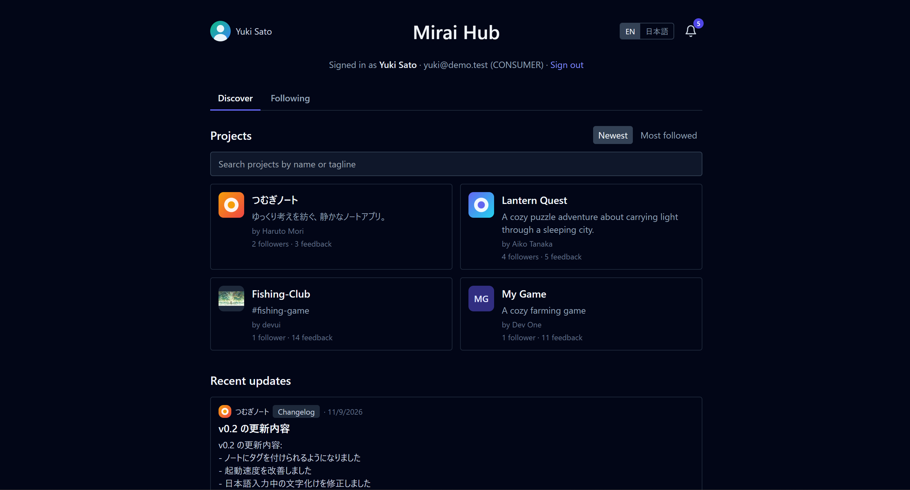
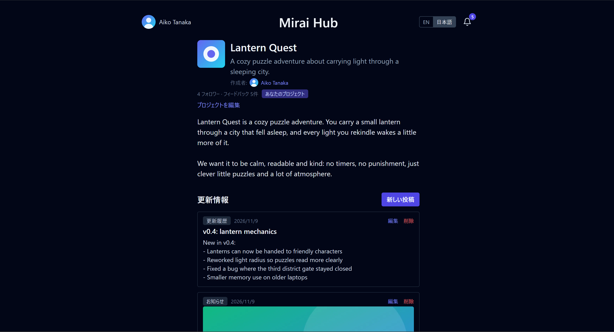
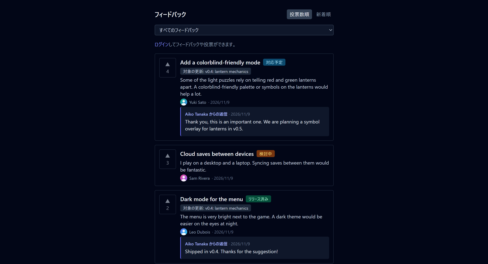
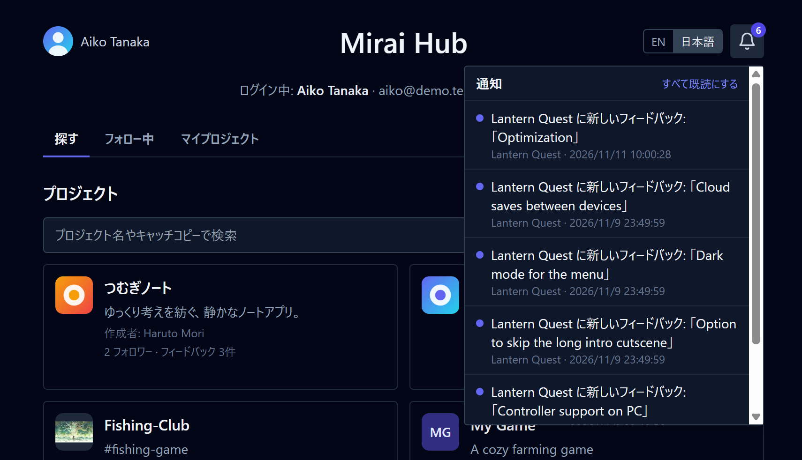
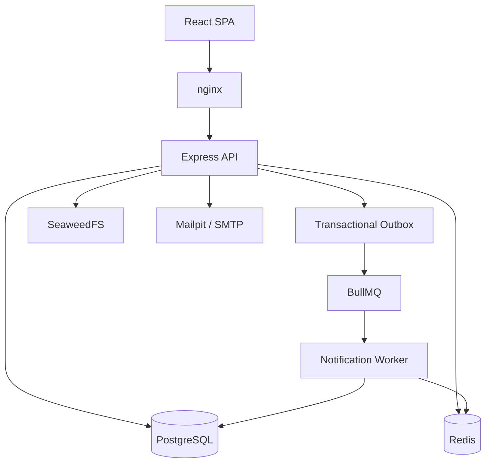

# Mirai Hub

[English](README.md) | [日本語](README.ja.md)

[](https://github.com/oracle-vfts-352/Mirai_Hub/actions/workflows/ci.yml)

**A feedback platform connecting developers and users.**

Mirai Hub is a web application where developers and companies can share their projects, publish updates, and collect feedback from users. Users can follow projects, submit feedback, and vote on ideas. Developers can respond by updating feedback statuses and posting official replies.

The goal is to close the feedback loop: users share their ideas, developers respond, and users are notified of the progress.

## Screenshots

Screenshots are available in [`docs/screenshots/`](docs/screenshots/).

| Home / Discover | Project Page |
|---|---|
|  |  |

| Feedback | Notifications |
|---|---|
|  |  |

## Features

### Authentication and Accounts
- Passkey-based registration and authentication
- Email verification
- Email-link sign-in
- JWT authentication using HttpOnly cookies
- Token revocation
- User profiles

### Project Discovery
- Browse public projects
- Search projects
- Discover, Following, and My Projects views
- Public project pages
- Follow and unfollow projects

### Feedback Management
- Submit feedback to projects
- Vote on feedback
- Link feedback to project posts
- Project owners can update feedback status:
  - Planned
  - In Progress
  - Shipped
  - Declined
- Project owners can provide one official reply per feedback item

### Notifications
- Notifications for feedback activity
- Notifications for status changes and official replies
- Notifications for project posts
- Asynchronous notification processing using an outbox pattern and BullMQ

### Internationalization
- English and Japanese UI
- Language toggle

## Tech Stack

| Category | Technology |
|---|---|
| Frontend | React 18, TypeScript |
| Styling | Tailwind CSS 3 |
| Build Tool | Vite 5 |
| Backend | Node.js, Express 4, TypeScript |
| Database | PostgreSQL 16 |
| ORM | Prisma 5 |
| Queue | BullMQ |
| Cache / Rate Limiting | Redis, ioredis |
| Authentication | WebAuthn / Passkeys, JWT |
| Validation | Zod |
| Testing | Vitest, Supertest |
| Object Storage | S3-compatible SeaweedFS |
| Email | Nodemailer, SMTP |
| Local Email Testing | Mailpit |
| Infrastructure | Docker Compose, nginx |
| CI | GitHub Actions |

## Architecture



The frontend is served through nginx, which also proxies API requests to the Express backend.

PostgreSQL stores application data. Redis supports rate limiting and BullMQ. Notification events are written to an outbox within the database transaction and then relayed to the queue. A worker processes queued events and creates notifications.

SeaweedFS provides local S3-compatible object storage, while Mailpit is used for local email testing.

## Engineering Decisions

### Transactional Outbox

Notification events are recorded in the database transaction alongside the related application changes. A relay publishes unpublished events to BullMQ.

This helps prevent notification events from being lost when a database operation succeeds but queue publishing fails.

### Asynchronous Notifications

Notification fan-out is handled by a worker instead of being performed entirely within the API request. This keeps API operations separate from notification processing.

### Passkeys and Verified Email

Authentication uses WebAuthn passkeys. Email verification and email-link sign-in are also supported.

### Redis-backed Rate Limiting

Rate limits are stored in Redis so they remain consistent across API instances and restarts.

### Idempotent Demo Seed

The demo seed script can be rerun and cleans up its demo accounts before recreating the data. It uses application service functions to preserve business rules and trigger normal events.

## Getting Started

### Prerequisites

- Node.js
- npm
- Docker Desktop
- Git

### 1. Clone the Repository

```bash
git clone https://github.com/oracle-vfts-352/Mirai_Hub.git
cd Mirai_Hub
```

### 2. Configure Environment Variables

Create the root `.env` file using `.env.example` as a template.

Configure the environment files required by the API and database packages:

- `apps/api/.env`
- `packages/database/.env`

Use local development values for the required secrets and database settings.

Do not commit `.env` files.

### 3. Start the Infrastructure Services

From the repository root:

```bash
docker compose up -d postgres-db redis-cache seaweedfs mailpit
```

This starts PostgreSQL, Redis, SeaweedFS, and Mailpit.

### 4. Start the API

Open a terminal:

```bash
cd apps/api
npm run dev
```

### 5. Start the Notification Worker

Open another terminal:

```bash
cd apps/api
npm run worker
```

The worker is required for asynchronous notifications to be processed.

### 6. Start the Frontend

From the repository root, open another terminal:

```bash
npm run dev:web
```

Open:

http://localhost:5173

Use `localhost` rather than `127.0.0.1` for local passkey development.

## Demo Data

The project includes a repeatable demo seed script.

From `apps/api`:

```bash
npm run seed
```

To clean the demo data:

```bash
npm run seed:clean
```

The seed script creates demo users, projects, posts, follows, feedback, votes, status changes, and official replies.

Demo accounts do not have passkeys registered. The development login mechanism is intended for local development only.

The notification worker should be running to see generated notifications.

## Running Tests

From the repository root:

```bash
npm test --workspace=api
```

The API test suite covers application services, routes, authentication-related logic, feedback workflows, notifications, and other backend behavior.

The project has **222 automated tests across 27 test files**, all passing at the latest reported test run.

## Continuous Integration

GitHub Actions runs the API checks and Docker builds.

The CI workflow includes API type checking, build, tests, and Docker image builds.

## Known Limitations

- No live production deployment
- No account deletion feature
- No image reporting mechanism
- Duplicate email registration returns `409 Conflict`, which can reveal whether an account exists
- Passkey registration and login have been manually tested; they are not fully covered by automated end-to-end tests
- Server error messages and emails are English-only
- Electron desktop shell is not implemented
- Production deployment requirements such as HTTPS, production email DNS, and cloud object storage configuration are not completed

## Roadmap

- [x] Core feedback loop
- [x] Project discovery and search
- [x] Passkey authentication
- [x] Email verification and email-link sign-in
- [x] Asynchronous notification processing
- [x] English / Japanese UI
- [x] Automated API tests
- [x] Docker-based local environment
- [ ] Electron desktop shell
- [ ] Optional free demo deployment

## License

This project is licensed under the MIT License. See [`LICENSE`](LICENSE) for details.
